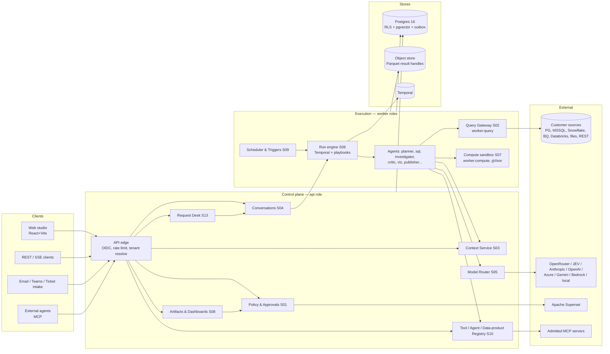
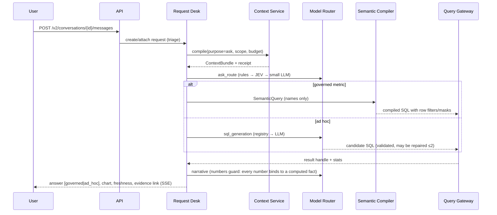

# Target architecture — Autonomous AI Analytics Platform (v2)

> **Invariant.** Models propose. Deterministic code authorizes, computes, verifies, versions and publishes.
> People approve side effects. Context outlives the conversation.

Baseline: the AnalystOS codebase (ADR-001). This document describes the target. Each module points to its
development spec in `docs/04-specs/`.

## 1. Logical view

## 2. Planes and trust boundaries

| Plane | Owns | Identity | Can reach |
|---|---|---|---|
| **Control** (`api`, `scheduler`) | tenants, workspaces, policies, context, conversations, registry, artifacts, approvals, audit | `app_rw` (RLS-bound) | Postgres, object store (metadata), Temporal, model providers (through router), Superset (through publisher) |
| **Query** (`worker:query`) | source credentials (just in time from vault), SQL execution, result handles | per-source `query_reader` | customer sources, object store `results/`. **Not** the control-plane DB except the query ledger table through a narrow role |
| **Compute** (`worker:compute`) | Python/statistics on result handles | none (no DB credentials) | object store (read the handle, write the output) through presigned URLs only. **No network otherwise** |
| **Model egress** | model calls | router service account | allowlisted provider hosts only (egress policy) |

Rules that hold across planes:
1. No model ever receives a credential, a raw secret ref, or rows from a column tagged `restricted`.
2. Every SQL statement from every path goes through `QueryGateway.execute` (S02).
3. Every side effect outside the platform (publish, notify, export, schedule, external tool with
   `side_effect != none`) goes through `approvals.verify_for_execution` immediately before acting.
4. Text from data, documents and tool outputs is *data*. It cannot add tools, widen scope or change policy.

## 3. Process roles and scaling (ADR-003)

| Role | Scales on | Typical (pilot) | Notes |
|---|---|---|---|
| `web` | HTTP RPS | 2 | static + nginx |
| `api` | RPS, SSE connections | 3 | stateless; SSE fan-out through Postgres `LISTEN/NOTIFY` (or Redis in `standard`) |
| `worker:analysis` | Temporal task-queue backlog | 2–6 | workflows + agent activities; LLM-bound |
| `worker:query` | per-source semaphore backlog | 2–4 per source class | separate pool for high-risk sources |
| `worker:compute` | compute queue backlog | 2–8 | gVisor runtime class, no egress |
| `scheduler` | — | 2 (claim-then-execute, safe to run several) | cron, monitors, trigger debounce |
| `migrate` | job | 1 | owns DDL with the `app_migrator` role |

Kubernetes: HPA on CPU for `api`/`web`. KEDA on Temporal queue depth for workers. PodDisruptionBudgets,
NetworkPolicies per role, and a `RuntimeClass: gvisor` for compute. Helm chart at `deploy/helm/` (inherited)
with `values-small|ha|airgapped`.

## 4. Deployment profiles (inherits AnalystOS ADR-0025 "lite by default")

| Profile | Services | Use |
|---|---|---|
| `lite` | postgres, api (in-process runner and scheduler), web | laptop demo, evaluation |
| `standard` | + temporal, worker roles, scheduler, minio, redis (optional) | team and pilot |
| `bi` | + superset | publishing |
| `events` | + redpanda | Kafka triggers and event sink |
| `airgapped` | standard + local model (vLLM/Ollama `openai_compatible`), decisions on rules | regulated |
| `ha` (Helm) | managed Postgres with PITR, Temporal cluster or Cloud, S3, ≥2 replicas per role | production |

## 5. Key flows

### 5.1 Ask (conversational, synchronous, bounded)

Escalation: if the classifier says complexity ≥ medium, ambiguity blocks, or the user says "investigate",
the turn becomes a goal run (5.2) linked to the same request and conversation.

### 5.2 Goal run (autonomous, durable)

`CREATED → CLASSIFIED → CONTEXT_READY → PLANNED → AUTHORIZED → RUNNING ⇄ PAUSED → VALIDATING → DRAFTED →
AWAITING_APPROVAL → PUBLISHED → COMPLETED`. Terminal states: `CANCELED | BLOCKED | FAILED | EXPIRED |
COMPLETED_WITH_LIMITATIONS`. Every transition is a typed `run_event` (actor, policy decision, correlation id) written
through the outbox. Plans are versioned (`plan_version+1` on replan, with a machine-readable reason). Steps are
idempotent on `(run_id, plan_version, step_key, input_hash)`. Details: S06.

### 5.3 Proactive

Trigger (cron | monitor threshold | freshness | signed webhook | Kafka) → debounce/dedupe/quiet-hours →
instantiate a **pinned** playbook version with the rule's pre-approved scope and budget → run →
alert with aggregates or a deep link only → notify through an approved channel, or request approval. Details: S09.

### 5.4 Publish

Draft dashboard version → validate (columns, units, sensitivity, audience) → preview → approval bound
to `sha256(bundle) + plan_hash` → publisher upsert by idempotency key → reconcile Superset IDs →
`publication` row. Rollback = republish of a previous version. Details: S08.

### 5.5 Context lifecycle

Crawl/import (DB metadata, dbt manifest, Superset, docs, OKF packs) → suggestions → human review →
versioned knowledge objects → Context Service (runtime) / OKF export (interchange). Conversations write
**summaries, accepted corrections and verified answers** to the Context Ledger, never raw result rows. Details: S03, S04.

## 6. Data architecture

* **System of record:** Postgres 16. Every tenant-owned table has `tenant_id` and RLS (ADR-009).
  Append-only `audit_event` (INSERT-only role and an `UPDATE/DELETE` trigger that raises).
* **Large payloads:** object store, `tenant/{t}/{kind}/{id}`, Parquet/Arrow, SSE-KMS, lifecycle TTLs per class
  (results 7d default, evidence pinned for the life of the publication, exports 24h).
* **Vectors:** pgvector HNSW in `knowledge_section.embedding`, `context_ledger_entry.embedding`. The embedding model
  is configurable (local default, ADR-0007), and the model id is stored per row so re-embedding is incremental.
* **Events:** `dispatch_outbox` → SSE/NOTIFY, and optionally Kafka. Payloads carry references only.
* **Lineage:** `lineage_edge` (Postgres). Exports: OpenLineage, DataHub (optional).

## 7. Cross-cutting

| Concern | Mechanism | Spec |
|---|---|---|
| AuthN | OIDC (PKCE for the UI, client credentials for API/MCP), JWKS cache, group → role mapping | S01 |
| AuthZ | RBAC + ABAC (classification, purpose, region, aggregation grain), checked on every tool call | S01 |
| Secrets | `secret_ref` schemes `env:`, `file:`, `vault:`, `aws-sm:`, `azure-kv:`, `gcp-sm:` resolved just in time in the query role | S02 |
| Budgets | per run, conversation, workspace, tenant per day: steps, wall clock, scan bytes, rows, LLM USD | S05, S06 |
| Observability | OpenTelemetry traces (`tenant`, `workspace`, `run`, `request` attributes; no payloads), Prometheus metrics, structured logs | S12 |
| Evaluation | golden questions, held-out corpus, adversarial suite, CI gates per model profile | S12 |
| Cost | `model_call`, `query_execution`, `worker_task` costs rolled up per request/run/workspace/tenant | S12 |

## 8. Module map (code packages → specs)

| Package (baseline `src/analystos/…`) | Spec | Change in v2 |
|---|---|---|
| `security/`, `governance/`, `db/` | S01 | + tenant, RLS, DB roles, audit immutability |
| `connectors/`, `gateway/`, `staging/`, `engines/` | S02 | + ADBC/Arrow handles, multi-source DuckDB, REST connector, connector certification kit |
| `knowledge/`, `context/`, `semantic/` | S03 | + Context Ledger API, MCP context tools, OKF round-trip CI |
| `services/ask*`, `AskThread/AskTurn` | S04 | + conversation memory tiers, summaries, cross-app read API |
| `llm/`, `decisions/` | S05 | + provider types, admin UI, per-tenant allowlists, model eval matrix |
| `runtime/`, `workflows/`, `agents/`, `capabilities/` | S06 | + goal API v2, budgets UI, complexity router |
| `skills/`, `methods/`, `evidence/`, `sandbox/`, `ml/` | S07 | + gVisor compute, forecast pack, claim labels v1 §7.2 |
| `artifacts/`, `publishing/`, `reports/` | S08 | + typed dashboard patch ops, conversational builder, per-tenant Superset |
| `services/{schedules,monitors,notifications}` | S09 | + webhook/Kafka ingress, debounce/hysteresis, recurring packs |
| `tools/`, `mcp/`, `registries/` | S10 | + data products as tools, manifest signing |
| `web/` | S11 | + Request Desk, Builder chat, Autonomy Center, Model admin |
| `core/`, `deploy/`, `scripts/` | S12 | + SLOs, alerting, chargeback, DR |
| new `desk/` | S13 | Analyst Request Desk |
