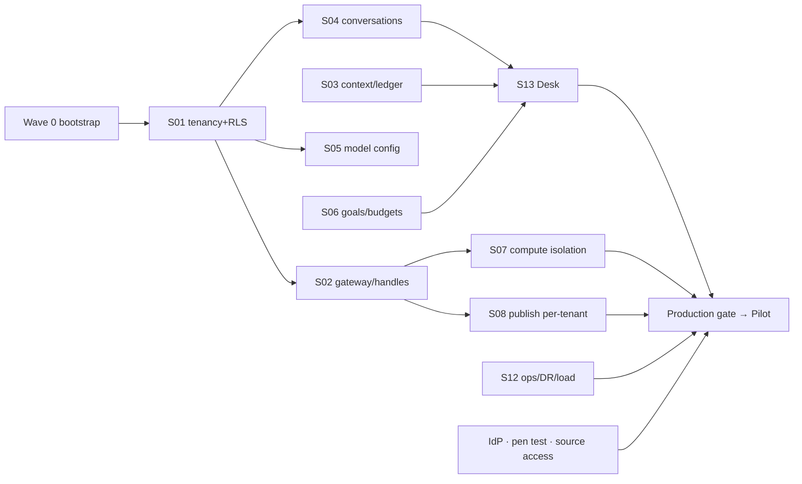

# Delivery plan — fast path to a production pilot

**Basis:** ADR-001 (build on AnalystOS). Task estimates come from the specs and are engineer-days for an engineer
fluent in the codebase and using AI coding agents. They are planning numbers, not commitments. Re-estimate after Wave 0.

## 1. Size

| Spec | P0/P1 effort (d) | P2 (d) |
|---|---|---|
| S01 Tenancy, identity, policy, audit | 13 | — |
| S02 Connectors, gateway, handles, multi-source | 20 | — |
| S03 Context Service, ledger, OKF | 11.5 | 3 |
| S04 Conversations and memory | 10.5 | — |
| S05 Model gateway | 16 | 5 |
| S06 Autonomy engine | 12 | 5 |
| S07 Analysis, verification, isolation | 12.5 | — |
| S08 Dashboards and publishing | 15.5 | — |
| S09 Monitoring, triggers, recurring | 12 | — |
| S10 Tool/agent/data-product registry, MCP | 11 | — |
| S11 Web UX | 16 | — |
| S12 Operations, observability, eval, cost | 18.5 | — |
| S13 Analyst Request Desk | 12 | — |
| **Total** | **≈ 180** | **13** |

With **5 engineers** (≈ 36 d each) plus 1 QA/evaluation lead, the build is about **8 weeks**. Integration, hardening and external
dependencies (IdP, pen test, live connector access) bring it to **~12 weeks to a production pilot**.

## 2. Workstreams

| Stream | Owns | Profile |
|---|---|---|
| A Platform & security | S01, S12 | backend/platform + security |
| B Data plane | S02, S07 | data engineer + backend |
| C Intelligence | S03, S04, S05, S06 | AI orchestration engineer |
| D Product surfaces | S13, S08, S11 | full-stack |
| E Automation & interop | S09, S10 | backend/integration |
| QA / Evaluation | golden suite, adversarial suite, AT harness, value metrics | QA/eval lead |
| Product owner | pilot domain, metric owners, class baselines, approvals policy | domain owner |

## 3. Waves

### Wave 0: Bootstrap (week 0–1)
- [x] ADR-001…014 accepted (owner delegated the decisions, 2026-10-27).
- [x] Seed this repo from AnalystOS with history (2026-10-27); POSIX-only worker tests marked (S07-T2). CI green on Linux still to confirm in CI.
- [ ] Freeze donors: sign the Atlas/DataPilot parity checklists; open rows for remaining Atlas ports (secret managers, provider adapters, MCP catalogue screen).
- [ ] Choose the **pilot domain**, 1–2 real sources, metric owners, and 20–50 golden questions with reference SQL.
- [ ] Price JEV (tracker N-13) and set the dev model policy (N-14) so live evaluation runs.
- [ ] Measure class baselines (practitioner protocol) for R1–R6 with the pilot team.

### Wave 1: Foundations (weeks 1–4) — started 2026-10-27: S01-T1…T4 done, T5 partial (see tracker) — exit: AT-05, AT-06, AT-13, AT-14, AT-15, AT-21 green
S01 (all) · S02-T1…T5 · S05-T1…T3, T6 · S07-T1…T3 · S12-T2 · S04-T1…T2 · S13-T1…T3

### Wave 2: Core product (weeks 4–7) — exit: AT-01, AT-02, AT-16…AT-20 green; Desk usable end to end
S03 (T1…T6) · S04-T3…T6 · S13-T4…T6 · S06-T1…T4 · S05-T4…T5 · S08-T1, T4, T5 · S11-T1…T3

### Wave 3: Expansion (weeks 7–10) — exit: AT-03, AT-04, AT-07…AT-12, AT-22…AT-24 green
S08-T2, T3, T6 · S09 (all) · S10 (all) · S06-T5 · S02-T6…T8 · S07-T4…T7 · S11-T5, T7, T8

### Wave 4: Production gate (weeks 10–12) — exit: §5 checklist complete
S12-T1, T3…T8 · customer IdP · pen test · live connector certification for pilot sources · DR drill · load test at 2× pilot.

### Pilot (weeks 12–20)
Real requests through the Desk. Weekly value report (auto-resolution, accepted rate, TTA, confident-wrong, cost). Certify
escalations. Go/no-go for broader rollout is decided on measured value and zero confident-wrong in sampled QA.

### Later (P2)
Playbook editor and simulator, context federation, DB-GPT-Hub local SQL model, causal designs (A/B, diff-in-diff),
process mining, story builder.

## 4. Critical path and dependencies

S01 goes first because adding `tenant_id` and RLS touches every table. Doing it later means re-migrating features
built in between.

## 5. Definition of done (every task)
1. Code + migration (expand/contract safe) + unit tests (no services) + integration tests (marked).
2. Contract updated (`contracts/*.json`, OpenAPI), regenerated web client.
3. Events added to `contracts/events.py` if the UI shows it; lineage edge if it has provenance.
4. The governance reviewer agent passes on diffs touching agents, gateway, governance, publishing or llm.
5. Tracker row updated with evidence (test path or dated live-run file). No row is Done without evidence.

## 6. Risks

| Risk | Likelihood | Impact | Mitigation |
|---|---|---|---|
| RLS retrofit breaks hidden query paths | High | High | Batched migrations; `TenantUnbound` raises in dev/test; full integration suite per batch |
| Baseline less complete than its docs claim | Medium | High | Wave 0 runs full unit + integration + e2e demo; re-estimate |
| Live connector access delayed | High | Medium | Start access requests in Wave 0; certify PG first |
| Model quality on customer schema below gates | Medium | High | Golden suite early; certified examples; escalation tier; local fine-tune (P2) |
| Value not demonstrated (analysts not freed) | Medium | High | Desk baselines in Wave 0; pilot measures; adjust class routing |
| Scope creep from four disciplines (ML, ELT) in baseline | Medium | Medium | Feature-flag ML/ELT off for pilot unless the pilot needs them |
| Single maintainer knowledge of baseline | Medium | Medium | Pairing; CLAUDE.md working agreement; ADRs |

## 7. Traceability (FR → spec → acceptance)

| FR | Spec | AT |
|---|---|---|
| FR-001,002,006,013,029,034,051 | S02 | AT-04, AT-12 |
| FR-003,009,041 | S04 (+S08) | AT-18 |
| FR-004,024,040,045,057 | S03 | AT-16, AT-17 |
| FR-005,007 | S02/S03 compiler | AT-01, AT-02 |
| FR-008,014,015,025,036,048 | S08 | AT-07, AT-08 |
| FR-010,011,017,019,058 | S06 | AT-03, AT-09, AT-11 |
| FR-012,016,037,044 | S01 | AT-05, AT-13 |
| FR-018,031,033,043 | S07 | AT-11, AT-21 |
| FR-020,021,022,049,050,054 | S09 | AT-10, AT-23, AT-24 |
| FR-023,035,046,047 | S10 | AT-22 |
| FR-026,055 | S12/S05 | eval gates |
| FR-027,038,039,056 | S05 | AT-14, AT-15 |
| FR-030 | S01/S02 | AT-06 |
| FR-032 | S03 | — |
| FR-042,053 | S13 | AT-19, AT-20 |
| FR-052 | S12 | — |
